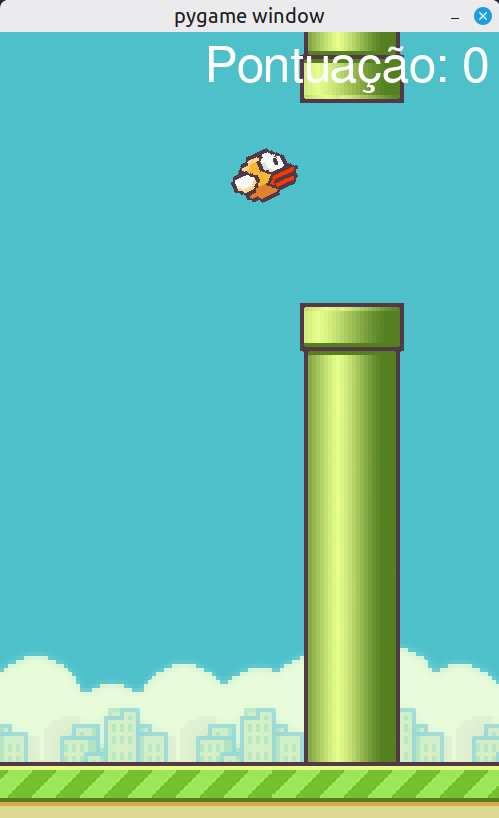
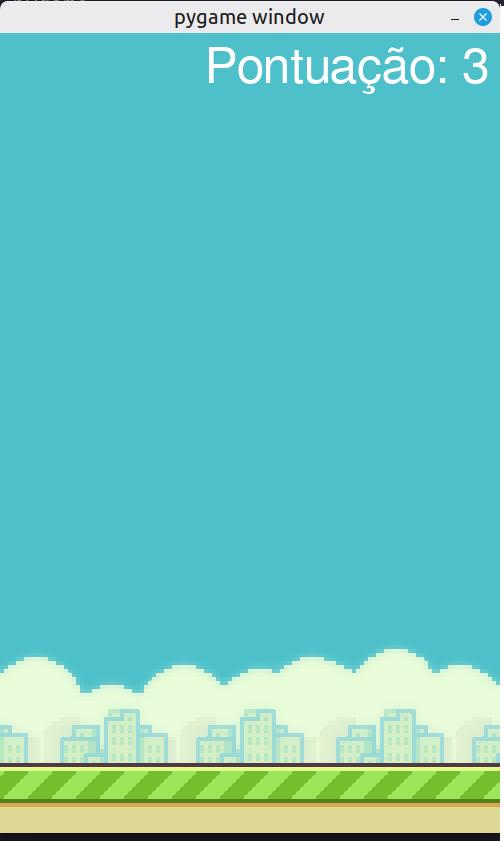

# Clone do Jogo Flappy Bird

Clone do jogo simples Flappy Bird, usando a biblioteca Pygame.

---

## Demonstração

| Início do Jogo | Game Over |
| :---: | :---: |
|  |  |

---

## Tecnologias

Este projeto foi desenvolvido utilizando as seguintes tecnologias:

- **Python 3.12.3**
- **Pygame (Criação de jogos simples)**

---

## Funcionalidades

- [x] Jogo similar ao Flappy Bird, codificado como forma de aprender conceitos básicos sobre programação de jogos

---

## Como Executar o Projeto

### Pré-requisitos

Antes de começar, você precisará ter instalado em sua máquina:
- [Git](https://git-scm.com)
- [Python 3.12](https://www.python.org/)

### Passo a Passo

1. **Clone este repositório:**
   ```bash
   git clone https://github.com/Brazil25/flappy_bird
   ```


2. **Acesse a pasta do projeto:**
   ```bash
   cd flappy_bird
   ```

3. **Crie e ative o ambiente virtual (opcional, mas recomendado):**
   ```bash
   python -m venv .venv
   source venv/bin/activate  # Linux/Mac
   # ou: venv\Scripts\activate  # Windows
   ```

4. **Instale as dependências:**
   ```bash
   pip install -r requirements.txt
   ```


5. **Execute a aplicação:**
   ```bash
   python main.py
   ```

---

## Licença

Este projeto está sob a licença MIT.
